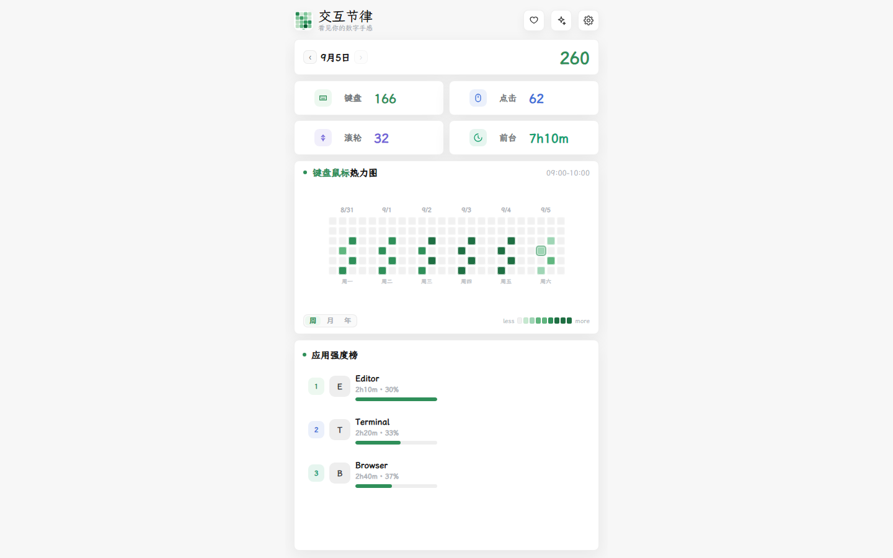

# 交互节律

**看见你的数字手感。** Windows 本地桌面工具，回看键盘响应、鼠标响应、前台应用与周节奏。

[**下载安装**](https://github.com/Ansel-Poiesis/interaction-rhythm-public/releases/latest) · [快速开始](#快速开始) · [它能做什么](#它能做什么) · [数据与隐私](#数据与隐私) · [关于技术路径](#关于技术路径)

## 快速开始

1. 打开 [Releases](https://github.com/Ansel-Poiesis/interaction-rhythm-public/releases/latest)，下载安装器 `interaction-rhythm-setup-v0.11.3.exe`，或便携包 `interaction-rhythm.zip`。
2. 安装器：双击并按提示安装；便携包：解压后运行 `InteractionRhythm.exe`。
3. 启动后会打开桌面窗口，并在系统托盘保留入口。先让它记录一会儿，晚上回来就能看到当天的手感。

> 当前版本为 `v0.11.3 / epoch 2`。安装器与便携包暂未做代码签名，Windows 可能提示「未知发布者」或 SmartScreen；选择「仍要运行」即可，并可用下方 SHA-256 核对下载完整性。

## 它能做什么

- 最近 6 天小时热力图，可切换键盘、鼠标和总响应视角。
- 前台应用强度榜与单应用分析，区分安静驻留、键盘冲刺、浏览筛选和碎片回返。
- 周复盘：键鼠 / 滚轮、前台秒数、高峰时段、Top 应用、输入趋势与回返节奏。
- 本地路径建议与可选 AI 深读：默认走本地规则，不调模型；主动配置 API Key 后才走云端，且只发送聚合字段。
- 导出 JSON / CSV，随时把数据带走。

## 界面预览

> 上图为 `v0.11.3` 主界面。演示数据为本地生成的合成记录，不包含任何真实使用痕迹。

## 数据与隐私

交互节律会记录：

- 每秒聚合的键盘按下、鼠标点击和滚轮次数。
- 前台应用名称与本地路径。
- 前台区间、采集健康、锁屏与休眠状态。

它不会记录具体按键、输入文字、鼠标坐标、屏幕截图、窗口标题或网页正文；默认不向任何服务器上传数据，未配置 API Key 时不会出站。数据保存在本机 `data/tracker.db`，可导出、压缩，并在设置中管理备份。

## 版本

- 版本清单见 [versions.json](versions.json)。
- 发布历史见 [Releases](https://github.com/Ansel-Poiesis/interaction-rhythm-public/releases)。
- `v0.11.3`：修复带时区前台区间的周趋势聚合，补齐测试依赖，并收束私有分发下的更新入口。

## 下载校验（SHA-256）

- `interaction-rhythm-setup-v0.11.3.exe`：`b446e8490bcfe79340cb72d3f8d69483e077ed42d0e8b57696444179d7269251`
- `interaction-rhythm.zip`：`64cb855effe5a639513f66f9c98a3dde26874e37fcaa7063378ad37465d267f6`

## 关于技术路径

本仓库是交互节律的公开分发面：提供安装器、便携包与使用文档，**不包含源码**。产品实现（采集、指标、本地服务与 AI 回放）保持私有，以保护技术路径。下载仅供个人使用；未经书面授权，请勿复制、修改、再分发或出售安装包及其中实现。

---

> 交互节律 · 扣舷而歌 · 看见你的数字手感
